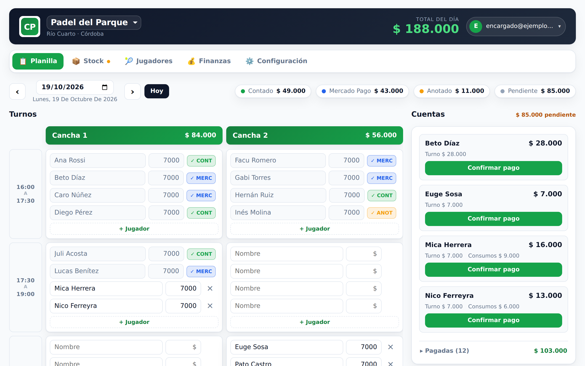
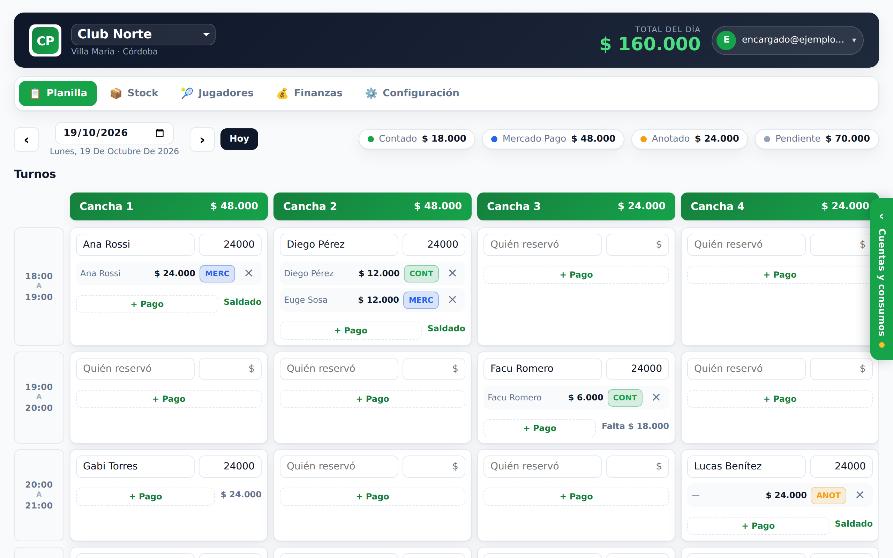
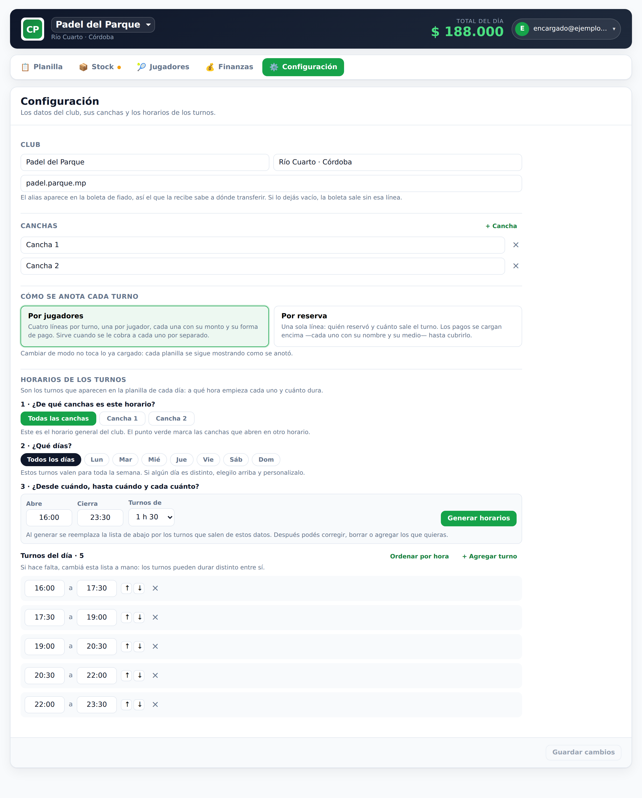
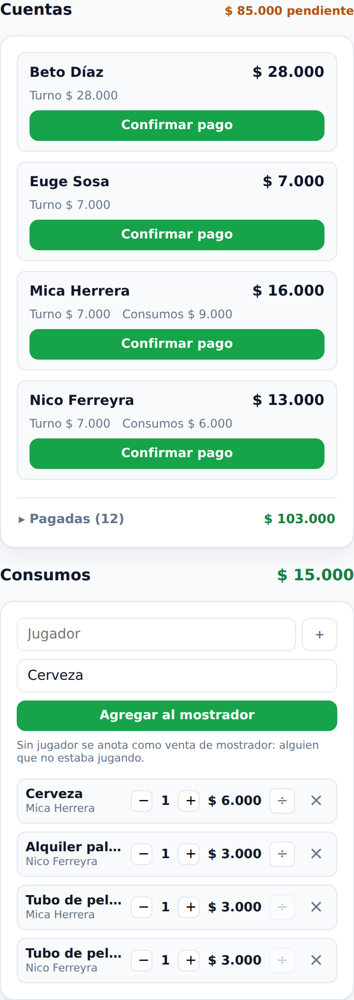
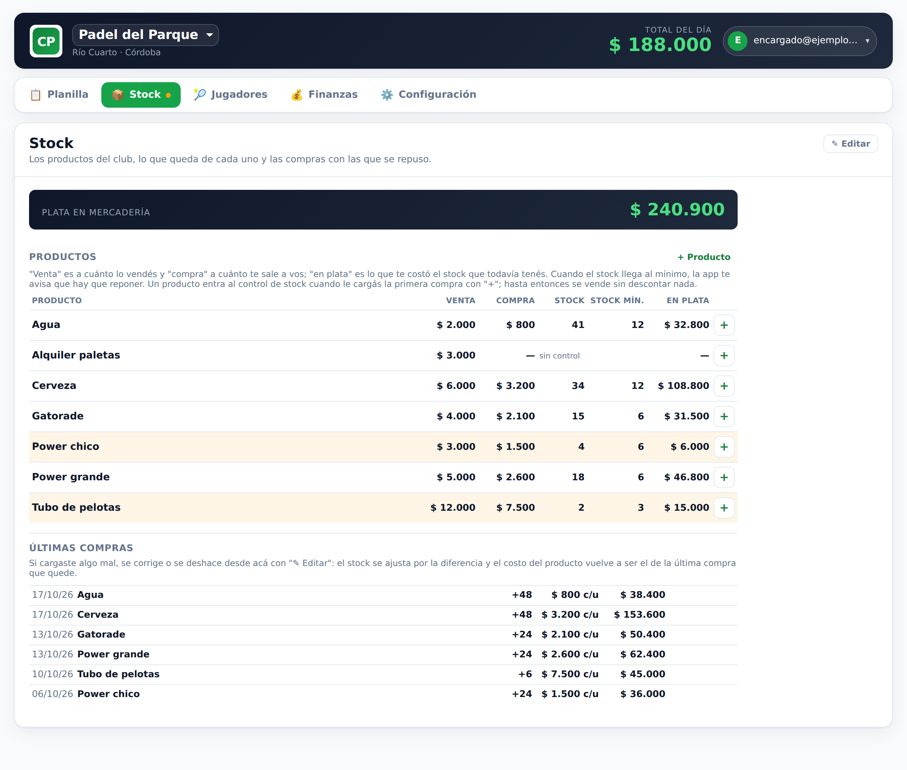
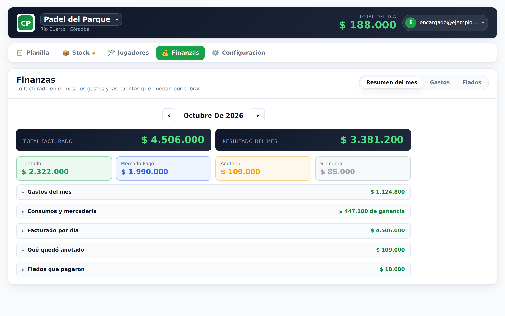
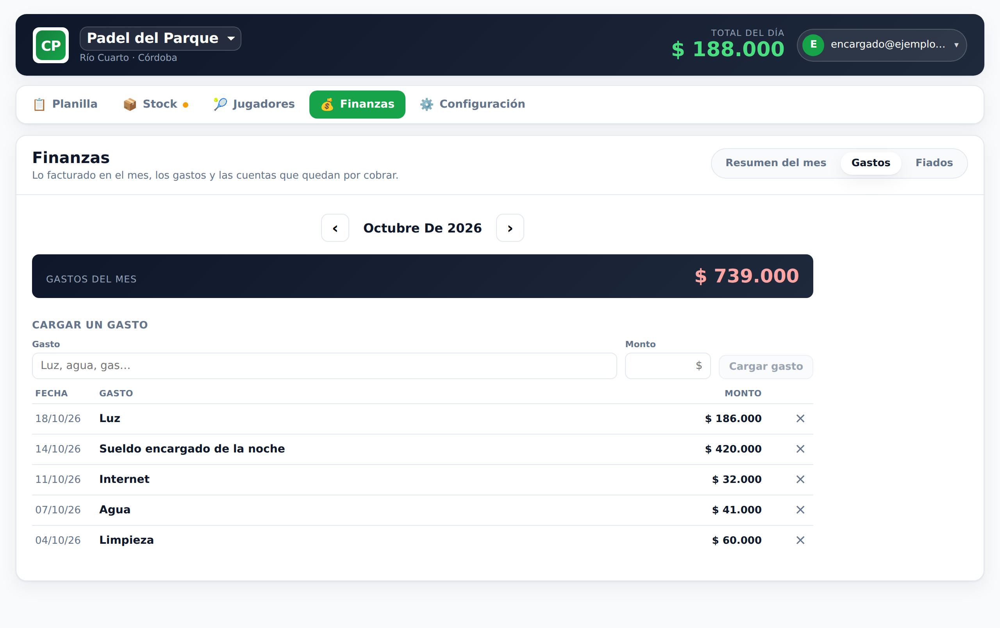
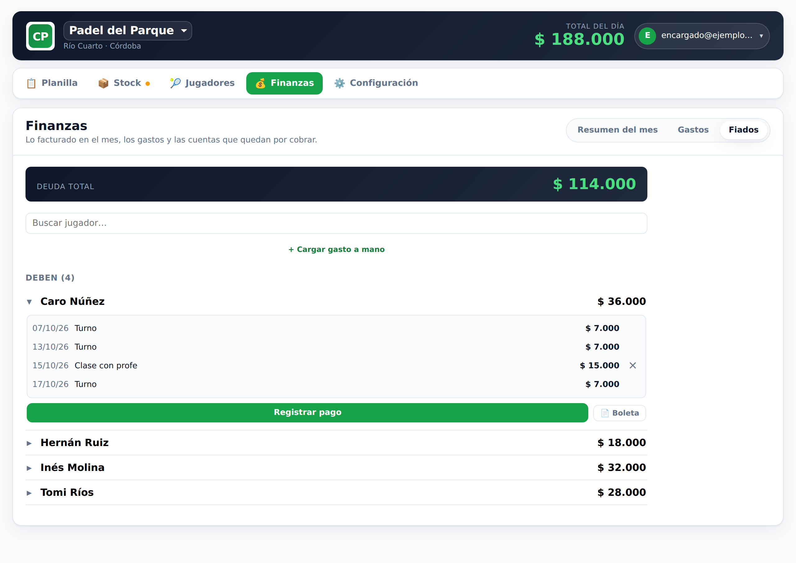
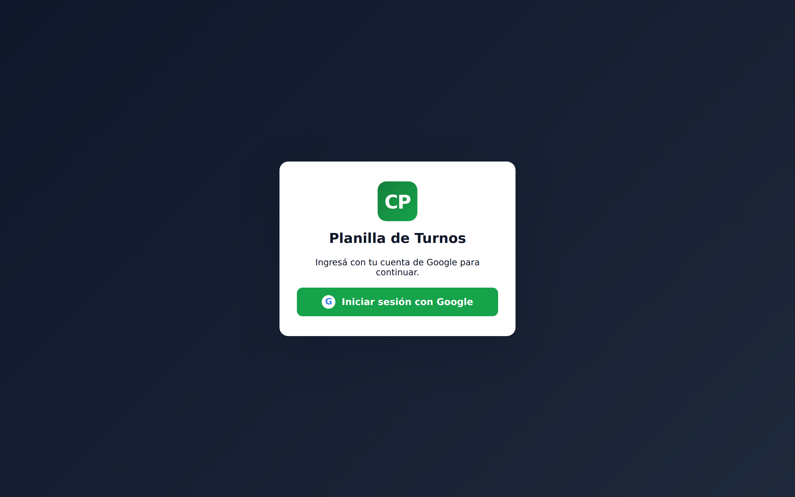
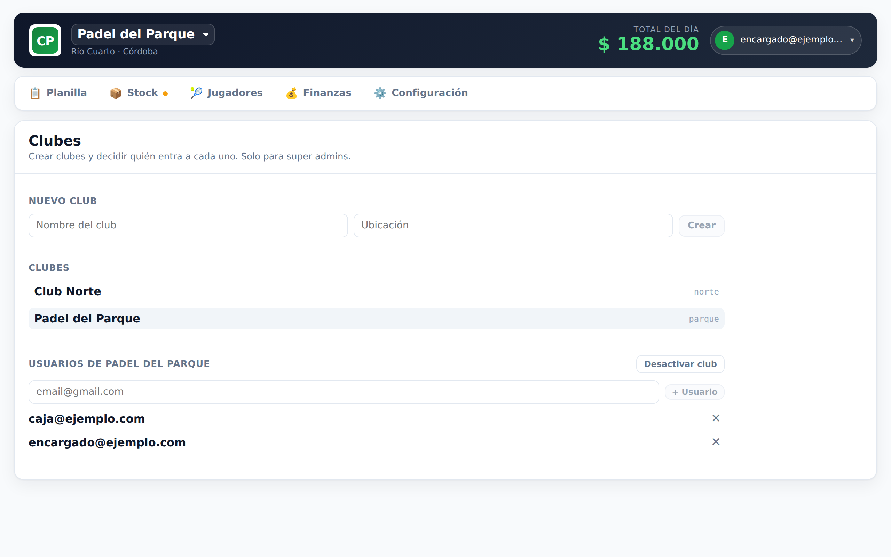

# Planilla de Turnos · Padel

App para anotar los turnos de las canchas de padel y los consumos que va sacando
cada jugador, reemplazando el Excel que se usaba en el club.

Construida con **Vite + React + Firebase** (Firestore + Auth con Google).
Una sola instalación atiende a **varios clubes**: cada uno ve únicamente sus
propios datos.



## Cómo está organizada

La app son cinco secciones, con pestañas arriba y una URL propia cada una
(`#/stock`, `#/finanzas`, …), así el botón atrás del navegador funciona y
recargar deja la tablet donde estaba:

| Sección           | Qué hay adentro                                              |
| ----------------- | ------------------------------------------------------------ |
| **Planilla**      | la grilla del día, las cuentas y los consumos                 |
| **Stock**         | los productos con su precio, lo que queda de cada uno y las compras |
| **Jugadores**     | el directorio de nombres que se sugieren al anotar            |
| **Finanzas**      | resumen del mes y fiados                                      |
| **Configuración** | datos del club, canchas y horarios                            |

La administración de clubes (crear clubes, dar de alta usuarios) está en el menú
de la cuenta, arriba a la derecha, y solo la ven los super admins.

## Qué hace

- **Grilla de turnos** por cancha y franja horaria, con dos formas de anotar que
  se eligen en Configuración:
  - **Por jugadores** (por defecto): cuatro líneas por turno, una por jugador,
    cada una con su monto y su tipo de pago (Contado / Mercado Pago / Anotado).
  - **Por reserva**: una sola línea con quién reservó y cuánto sale el turno; los
    pagos se cargan encima —cada uno con su nombre y su medio— hasta cubrirlo, y
    la celda muestra cuánto falta. Sirve para los clubes que solo anotan a quien
    reserva y le cobran después.

  Cambiar de modo no toca lo ya cargado: cada turno se sigue mostrando como se
  anotó.

  
- **Horarios**: se cargan diciendo a qué hora abre y cierra el club y cuánto
  dura el turno, y la app genera las franjas (después se pueden retocar a mano).
  Cada cancha puede tener su propio horario, y cualquiera de los dos —club o
  cancha— puede tener uno distinto para un día de la semana. En la planilla las
  canchas se agrupan por horario: las que coinciden comparten una columna de
  horarios, y cada grupo distinto arma su propia tabla al lado.

  
- **Panel de consumos** con selector de productos del club (cerveza, agua, etc.),
  cantidad y tipo de pago. Un producto se puede **dividir entre varios
  jugadores** (el tubo de pelotas que pagan entre cuatro) y, si no se anota
  jugador, queda como **venta de mostrador**: alguien que no estaba jugando, con
  su propio cobro. En clubes de 3 canchas o más, Cuentas y Consumos dejan la
  columna del costado y se abren desde la solapa del borde derecho, para que la
  planilla use todo el ancho de la pantalla.

  
- **Stock** de la mercadería: se carga con las compras (cantidad y costo) y cada
  consumo lo descuenta solo. Muestra cuánta plata hay en mercadería, avisa qué
  hay que reponer —con un punto en la pestaña— y en el resumen del mes calcula la
  ganancia de los consumos. Una compra cargada mal se corrige o se deshace, y el
  costo del producto vuelve a ser el de la última compra que quede. Un producto
  sin compras cargadas se vende sin descontar nada.

  
- **Totales del día** discriminados por tipo de pago, en tiempo real.
- **Navegación por fecha**: cada día tiene su propia planilla.
- **Finanzas**: el **resumen del mes** (facturado por medio de pago, gastos,
  ganancia de los consumos y resultado), los **gastos** del club y los
  **fiados**, con el detalle de qué debe cada uno y la boleta para mandarle.

  | Resumen del mes | Gastos | Fiados |
  | --- | --- | --- |
  |  |  |  |
- **Multi-club**: quien trabaja en más de un club lo elige desde el header.

## Quién entra y a qué

- **Usuario de un club**: su email figura en `clubs/{clubId}/miembros`. Puede
  usar y configurar la planilla de ese club, y nada más.
- **Super admin**: su email figura en `superAdmins`. Crea clubes y decide qué
  usuarios entran a cada uno, desde el botón ★ del header. Para *usar* la
  planilla de un club también tiene que agregarse como usuario de ese club.

El alta de super admins **no se hace desde la app**: se carga a mano un
documento en `superAdmins/{email}` desde la consola de Firebase. Es el único
privilegio que no puede otorgarse desde adentro.

| Ingreso | Administración de clubes (super admin) |
| --- | --- |
|  |  |

## Puesta en marcha

```bash
npm install
cp .env.example .env   # completar con los datos del proyecto Firebase
npm run dev
```

> Sin `.env` la app corre en **modo demo** con un club local y guarda todo en
> `localStorage` del navegador.

### Configurar Firebase

1. Crear un proyecto en <https://console.firebase.google.com>.
2. Agregar una app **Web** y copiar las credenciales al `.env`.
3. En **Authentication → Sign-in method**, habilitar **Google**.
4. En **Firestore Database**, crear la base y publicar las reglas:
   `firebase deploy --only firestore:rules,firestore:indexes`.
5. Crear a mano el documento `superAdmins/{tu-email}` para poder administrar.

## Estructura de datos en Firestore

```
superAdmins/{email}                     quién puede administrar clubes
clubs/{clubId}                          { nombre, ubicacion, activo, creado }
  ├─ miembros/{email}                   quién entra a este club
  ├─ config/club                        canchas, horarios y productos
  ├─ planillas/{YYYY-MM-DD}             { turnos, consumos, mostrador }
  ├─ jugadores/{id}                     directorio del club
  └─ fiadoPagos|fiadoCargos|fiadoCortes|fiadoArchivados/{id}
```

El aislamiento entre clubes lo garantizan las reglas (`firestore.rules`), no la
UI: un usuario que no es miembro de un club no puede leer ni escribir nada de
ese club aunque conozca su id.

## Entorno de pruebas local

El emulador de Firebase permite trabajar sobre una **copia de los datos reales**
sin tocar producción.

```bash
npm run emulators                 # levanta Firestore + Auth + UI (puerto 4000)
npm run db:dump                   # copia producción → firestore-dump/latest.json
npm run db:seed -- --reset --super=tu-email@gmail.com   # carga esa copia en el emulador
npm run dev:emulator              # la app apunta al emulador (aviso visible en pantalla)
```

`db:dump` necesita credenciales de administrador: o bien
`gcloud auth application-default login`, o bien una clave de cuenta de servicio
(Consola Firebase → Configuración → Cuentas de servicio → Generar clave privada)
guardada como `service-account.json` en la raíz. El dump y la clave están
ignorados por git.

En el emulador el login con Google no pide contraseña: abre un popup donde se
elige o inventa una cuenta de prueba.

### Probar las reglas

```bash
npm run emulators      # en otra terminal
npm run test:rules
```

Verifica que un club no pueda ver los datos de otro, que nadie se agregue solo a
un club y que solo el super admin dé de alta usuarios.

### Capturas del README

Las imágenes de `docs/capturas/` las genera un script, así se rehacen cada vez
que cambia algo que se ve:

```bash
npm run capturas
```

Levanta su propio emulador (Firestore en 8180, Auth en 9299, para convivir con
otro que esté abierto en los puertos de siempre), carga dos clubes inventados
—**Padel del Parque**, por jugadores y con un mes de movimiento, y **Club
Norte**, por reserva y con cuatro canchas— y saca una foto de cada sección con
Playwright a tamaño tablet. No toca producción. El script está en
[scripts/capturas/capturas.mjs](scripts/capturas/capturas.mjs).

La primera vez hace falta el navegador de Playwright
(`npx playwright install chromium`) y una fuente de emojis instalada en el
sistema (por ejemplo Noto Color Emoji), si no los íconos de las pestañas salen
como cuadraditos.

## Migración a multi-club

La base vieja tenía las colecciones en la raíz (`config`, `planillas`,
`jugadores`, `fiado*`, `allowlist`). El script las copia bajo `clubs/{clubId}`
sin borrar nada del origen:

```bash
npm run db:migrate -- --emulator --dry-run    # simulación sobre la copia local
npm run db:migrate -- --emulator              # migrar en el emulador y probar la app
npm run db:migrate                            # migrar PRODUCCIÓN
npm run db:migrate -- --limpiar               # recién después de verificar: borra lo viejo
```

Opciones: `--club=carest`, `--nombre="Carest Padel"`, `--ubicacion="…"`.
Los emails de `allowlist` se convierten en los miembros del club migrado.

Después de migrar, `npm run db:check [-- --emulator]` verifica que la copia sea
fiel: compara documento por documento y recalcula, **con el código de la app**,
el resumen de cada mes y la deuda de fiados de los dos lados. Si algún número
cambia, lo dice y termina con error.

El paso a paso para migrar un club que ya está en uso —con backup, ensayo en el
emulador y vuelta atrás— está en [MIGRACION.md](MIGRACION.md).

## Logo

Colocá el logo del club en `public/logo.svg` y aparece en el header (y como
favicon). Si no existe, simplemente no se muestra.

## Build

```bash
npm run build      # genera dist/
npm run preview    # sirve el build localmente
```
